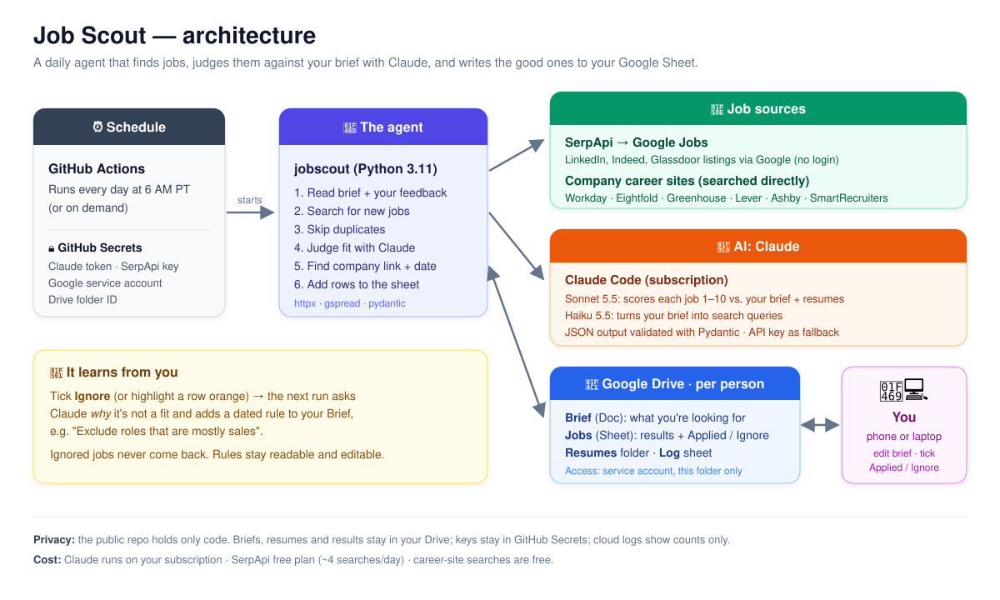

# Job Scout

A small agent that runs in the cloud every morning. It finds new job postings, judges each one
against a **free-text brief** you write, looks up basic facts about the company, and appends the
good ones to a **Google Sheet**, ready to triage over coffee. It supports several people, each with
their own folder, brief and sheet.



| Block | Technologies |
|---|---|
| ⏰ **Schedule** | GitHub Actions, every morning (6:17 AM PT, plus two backup slots); GitHub Secrets for keys and tokens |
| 🐍 **The agent** | `jobscout`, Python 3.11 (httpx, gspread, pydantic): read brief + feedback → search → skip duplicates → judge with Claude → find company link + date → add rows |
| 🔎 **Job sources** | SerpApi → Google Jobs (LinkedIn / Indeed / Glassdoor listings, no login); company career sites searched directly: Workday, Eightfold, Greenhouse, Lever, Ashby, SmartRecruiters |
| 🧠 **AI: Claude** | Claude Code on your subscription (Anthropic API as fallback): Sonnet 5.5 scores each job 1–10 against your brief + resumes; Haiku 5.5 turns the brief into searches; JSON output validated with Pydantic |
| 📁 **Google Drive** | One folder per person: Brief (Doc), Jobs (Sheet with Applied / Ignore checkboxes), Resumes, Log; a service account with access to this folder only |
| 👩‍💻 **You** | Edit the brief, tick Applied / Ignore, from phone or laptop |
| 🔁 **Learns from you** | Applied / Ignore ticks become examples the judge sees on the next run; Ignore (or an orange highlight) also adds a dated rule to your Brief; ignored jobs never come back |
| 📏 **Eval** | Your own Fit / Not fit labels on frozen real postings; measures the judge's agreement, precision and recall before and after every change ([Evaluation](#evaluation-is-the-judge-right)) |

More detail (flows, data model, design notes): [docs/ARCHITECTURE.md](docs/ARCHITECTURE.md)

- **No LinkedIn login, no cookies, no scraping.** LinkedIn postings come in through Google for Jobs
  (via [SerpApi](https://serpapi.com/google-jobs-api)). When a posting has a LinkedIn link, that link goes in the sheet.
- **Your private data never enters this repo.** Briefs, salary expectations, feedback and results live in your
  Drive. The repo holds only code. Keys and the folder ID are GitHub Secrets.
- **Least privilege.** The agent uses a Google *service account* that can only see the one folder you share with it.
- **Append-only.** The agent never edits or deletes your rows. It only appends rows to the sheet, plus dated
  "Learned exclusions" lines at the end of the brief.

## What's in each person's folder

| File | What it is |
|---|---|
| **Brief** (Google Doc, or a `.txt`) | Your search brief in plain language. Edit it any time, including from your phone. Learned exclusions are added at the bottom. |
| **Resumes** (subfolder, optional) | Your resume library: the resumes you've already sent out (Google Docs, PDF, Word .docx, .txt). Claude searches for roles similar to the ones they're tailored to, judges each job against the closest one, and names it in the **Best resume** column. Up to 8 most recently modified files are used. |
| **Log** (Google Sheet, optional) | Run history with cost per run. You create it empty; the agent adds a **Runs** tab. |
| **Jobs** (Google Sheet) | You create it empty. The agent adds three tabs: **Jobs** (results), **Log** (one row per run) and a hidden **_state** tab (bookkeeping), plus an **Eval** tab if you use the [eval](#evaluation-is-the-judge-right). |

**Jobs tab columns:** **Applied** (checkbox) · **Ignore** (checkbox) · Date added · Fit score (1–10) · Job title · Company · Why it fits · Concerns / red flags ·
Location · Work mode · Employment type · Seniority · Salary range · Equity mentioned · Posted date ·
Company type / industry · Company size · Funding stage / public · HQ · Company description · Job URL ·
Company website · Source · **Status** (dropdown) · **My feedback** · **Best resume** · **LinkedIn URL** · **Company job URL** · **Date opened**

Company facts come from a web search by Claude. Anything it can't confirm is written as `unknown`, never guessed.

## What it needs from you (keys, tokens and where each one goes)

| What | Where to get it | Local run (`.env`, gitignored) | Cloud run (GitHub → Settings → Secrets → Actions) |
|---|---|---|---|
| **Claude subscription token** | In a terminal run `claude setup-token`, log in, copy the `sk-ant-oat01-…` it prints (valid ~1 year) | Not needed: uses your logged-in Claude Code | `CLAUDE_CODE_OAUTH_TOKEN` |
| **SerpApi key** | serpapi.com → sign up (free: 250 searches/month) → serpapi.com/manage-api-key | `SERPAPI_API_KEY` | `SERPAPI_API_KEY` |
| **Google service account key** | Google Cloud Console → project → IAM → Service accounts → Keys → Add key → JSON (Setup step 3) | `GOOGLE_SERVICE_ACCOUNT_FILE=./secrets/service-account.json` (path to the file) | `GOOGLE_SERVICE_ACCOUNT_JSON` (the file's **entire contents**) |
| **Drive folder ID** | Your "Job Scout" folder's URL: `drive.google.com/drive/folders/<ID>` | `JOBSCOUT_ROOT_FOLDER_ID` | `JOBSCOUT_ROOT_FOLDER_ID` |

**Not needed: Anthropic API key.** Claude runs on your Claude subscription through Claude Code, both locally and in the
cloud. `ANTHROPIC_API_KEY` is only a legacy fallback, used if Claude Code isn't installed or the cloud token is
missing. It is never used when your weekly Claude usage runs out; the run stops instead. Leave it unset unless you
deliberately want pay-as-you-go API billing (`JOBSCOUT_LLM_BACKEND=api`).

Also required, though not secrets:
- In the Google Cloud project, the **Drive, Sheets and Docs APIs are enabled**.
- The **Job Scout folder is shared** with the service account's email (`…@….iam.gserviceaccount.com`) as **Editor**.
- Each person's subfolder has a `Brief` Google Doc and an empty `Jobs` Google Sheet. `Resumes` and `Log` are optional.
- Locally: **Claude Code installed and logged in** (`claude`), plus Python 3.10+.
- For setting secrets from the terminal: the GitHub CLI, logged in with the `workflow` scope (`gh auth refresh -s workflow`).

Setting the cloud secrets from a terminal (paste each value when asked; never paste keys into chats or commits):
```bash
gh secret set CLAUDE_CODE_OAUTH_TOKEN
gh secret set SERPAPI_API_KEY
gh secret set GOOGLE_SERVICE_ACCOUNT_JSON < secrets/service-account.json
gh secret set JOBSCOUT_ROOT_FOLDER_ID
```

Optional settings (env vars locally, or extra secrets/variables in CI), defaults in brackets:
`JOBSCOUT_LLM_BACKEND` [auto: claude-code if installed, else api] · `JOBSCOUT_MAX_QUERIES` [4] ·
`JOBSCOUT_MAX_NEW_ROWS` [25] · `JOBSCOUT_MIN_FIT_SCORE` [6] · `JOBSCOUT_MAX_AGE_DAYS` [7] ·
`JOBSCOUT_PER_COMPANY` [5] · `JOBSCOUT_WATCH_MAX_AGE_DAYS` [90] · `JOBSCOUT_MAX_LOOKUPS` [0] ·
`JOBSCOUT_SERP_CACHE_HOURS` [20].

## Setup (one time, ~20 minutes)

### 1. Install

```bash
git clone https://github.com/<you>/job-scout && cd job-scout
python3 -m venv .venv && source .venv/bin/activate
pip install -e '.[dev]'
cp .env.example .env
```

### 2. Claude + SerpApi

- **Claude.** Install Claude Code and log in (`claude`). Local runs use your Claude subscription automatically, so no API key
  is needed. For the cloud run, create a token with `claude setup-token` (see step 6).
- **SerpApi.** Sign up at <https://serpapi.com> (the free plan gives 250 searches a month) and copy your key from
  <https://serpapi.com/manage-api-key> into `.env` as `SERPAPI_API_KEY`.
  By default each person uses up to 4 searches per run, so 2 people × 4 × 30 days = 240 a month.

### 3. Google service account (the robot that edits your sheets)

A service account is not a Google account. It's a robot identity with an email address. It can only open
what you share with it. You can create it from your personal Google account or from a separate one.

1. **Create a project:** go to <https://console.cloud.google.com/projectcreate>, name it `job-scout` and click **Create**. Make sure
   it's selected in the project picker at the top of the page.
2. **Enable 3 APIs.** Open each link and click **Enable**:
   - Google Drive API: <https://console.cloud.google.com/apis/library/drive.googleapis.com>
   - Google Sheets API: <https://console.cloud.google.com/apis/library/sheets.googleapis.com>
   - Google Docs API: <https://console.cloud.google.com/apis/library/docs.googleapis.com>
3. **Create the service account:** go to <https://console.cloud.google.com/iam-admin/serviceaccounts>, click
   **+ Create service account** and name it `job-scout`. Click **Create and continue**, skip the roles step, then click **Done**.
4. **Download its key:** click the new account's email, open the **Keys** tab, click **Add key → Create new key → JSON**, then **Create**.
   Move the downloaded file to `secrets/service-account.json` in this project (the `secrets/` folder is gitignored).
5. **Copy the service account's email** (`job-scout@<project>.iam.gserviceaccount.com`). You'll need it next.

> If Google says key creation is disabled by an organization policy, you're using a work/Workspace account.
> Use a personal Google account instead.

### 4. Drive folders

1. In Google Drive, create a folder called **Job Scout**.
2. **Share it** with the service account email as **Editor**, and untick "Notify people".
3. Inside it, create **one subfolder per person** (e.g. `alex`, `sam`). The folder name is the profile name.
4. In each person's subfolder, create:
   - a **Google Doc named `Brief`**. Paste the template from `python -m jobscout template` and fill it in.
   - an **empty Google Sheet named `Jobs`**.
   - optionally a **`Resumes`** subfolder with the resumes you've sent.
5. Copy the **Job Scout** folder's ID from its URL (`drive.google.com/drive/folders/`**`<THIS_PART>`**) into `.env`
   as `JOBSCOUT_ROOT_FOLDER_ID`.
6. Check everything:
   ```bash
   python -m jobscout setup
   ```
   This lists every person's folder, confirms it can read the brief, and adds the Jobs / Log / _state tabs, headers,
   frozen header row and Status dropdown to each sheet. You can run it again safely: it never overwrites content.

### 5. First run

```bash
python -m jobscout run --profile alex --dry-run    # prints what it would add; writes nothing
python -m jobscout run --profile alex              # writes to the sheet
python -m jobscout run --profile all
```

### 6. Schedule it (GitHub Actions)

Add four repository secrets: **Settings → Secrets and variables → Actions**, or from a terminal:

```bash
claude setup-token                      # optional: prints a long-lived token for your Claude subscription
gh secret set CLAUDE_CODE_OAUTH_TOKEN   # paste it; cloud runs then use the subscription instead of API credit
gh secret set SERPAPI_API_KEY
gh secret set GOOGLE_SERVICE_ACCOUNT_JSON < secrets/service-account.json
gh secret set JOBSCOUT_ROOT_FOLDER_ID
```

`.github/workflows/daily.yml` runs every person in the folder daily. Each person's run is separate, so one failure
doesn't block the others. You can start a run by hand under **Actions → Daily job scout → Run workflow**, or with
`gh workflow run "Daily job scout"`.

**About the time.** GitHub's cron runs on UTC and **does not follow daylight saving time**. The main slot
`17 14 * * *` is **6:17 AM PST** in winter and **7:17 AM PDT** in summer. To get ~6 AM in summer instead, use
`17 13 * * *` (which means 5:17 AM in winter).

**Backup slots.** GitHub's scheduled runs are best-effort: they can start hours late or be skipped entirely,
most often at the top of the hour. So the workflow has two backup slots (7:47 AM and 10:17 AM PST). Each one
first checks whether a run already succeeded today (UTC) and exits in seconds if so, so a normal day still has
exactly one real run. GitHub also pauses schedules in repos with no activity for 60 days; a push or a manual run
re-enables them.

**Public logs.** This repo is public, so its Actions logs are too. In CI the agent logs only counts and error
types, and refers to people as `profile-1`, `profile-2`. It never prints briefs, search queries, job details or folder names.

## Adding a person (5 minutes)

1. Create a subfolder for them in **Job Scout**, with a `Brief` doc and an empty `Jobs` sheet.
2. Share their subfolder with them, so they can edit their own brief and sheet.
3. Optionally add a `Resumes` subfolder with their resumes.
4. Run `python -m jobscout setup`. That's it. No config change and no secret update; the next daily run includes them.

## Writing a good brief

The brief is passed **word for word** to Claude as the judging criteria, so write it the way you'd brief a
recruiter friend. The template's sections:

- **About me.** Paste your resume, or a few lines on your experience, skills and location. Claude uses it to judge
  whether *you* are a strong candidate. It cites the matching experience in "Why it fits", and when a posting has a hard
  requirement you clearly lack (clearance, license, far more years) it scores the job low and names the gap in Concerns.
- **Target roles.** List the actual titles, and also say what the work is ("customer-facing engineering, building
  with customers' data"). Claude also turns this section into the search queries.
- **Seniority, location / remote, employment type.** Be specific: "Remote (US), or hybrid ≤2 days in SF".
- **Compensation.** State hard rules explicitly. For example: *"Base salary required, $150k+. Salary + equity is
  great. Equity-only does NOT count — exclude."* A posting that doesn't list a salary is kept and flagged in Concerns,
  not dropped. A posted range whose top is below your minimum is excluded.
- **Company preferences.** Stage, size, industry, and anything that should raise the score.
- **Don't show me.** Hard exclusions, one per line: "staffing agencies", "on-site 5 days in SF", "crypto".
- **Companies to watch (optional).** One company per line: a name like `Acme Corp`, a careers URL, or `greenhouse:slug`.
  Their own career sites are searched directly on every run (see Sources). Lines starting with `#` are ignored.

Tips:
- Say what's a **must** and what's a **nice to have**. Claude excludes on the musts and scores on the nice-to-haves.
- Short bullets work better than long paragraphs.
- If results are too broad, add to "Don't show me" or give feedback (below). If they're too narrow, loosen the musts.

## Links: company career site, date opened, LinkedIn

For every new row the agent tries to find the job **on the company's own careers site** (its applicant tracking system):

1. It detects the company's careers system from the apply links Google Jobs returned: Workday, Eightfold, Greenhouse,
   Lever, Ashby or SmartRecruiters.
2. If that's missing, it does one extra Google Jobs search for this exact job (SerpApi, budget-capped; see below). That search
   lists every site the job is posted on.
3. Otherwise it tries the company's public Greenhouse/Lever/Ashby board by name. As a last resort, once per company, it asks
   Claude to find the company's careers site. What it learns about each company is cached in the hidden `_state` tab.
4. It searches that careers site for the job title and takes the exact posting URL and the **exact date opened**.

What you'll see in the columns:
- **Company job URL:** the posting on the employer's site. If the company's careers system is known but doesn't list the job,
  it says `not listed on company site (may be closed)`. That usually means the job is closed or was only reposted by a job
  board. `not found` means the company's careers site couldn't be searched. Any URL that doesn't come straight from a careers
  system is checked before it's written: it must load, must not redirect to a search page, and must show the job title.
- **Date opened:** e.g. `2026-10-30 (workday)` when exact, or `~2026-10-28 (job board)` when it's approximate.
- **LinkedIn URL:** the exact `linkedin.com/jobs/view/<id>` posting when Google lists one for that job, otherwise `not found`.
  The agent never logs in to or opens LinkedIn. Many companies don't post every job on LinkedIn, and LinkedIn keeps many
  postings out of Google, so `not found` is common.

**SerpApi budget:** the extra lookups (step 2) are off by default. Set `JOBSCOUT_MAX_LOOKUPS` (e.g. 3) to enable them. They're
skipped entirely when fewer than `JOBSCOUT_SERPAPI_RESERVE` (default 40) searches are left this month, so the daily search
always keeps working. With two people, the free plan (250/month) runs short. SerpApi Starter ($25/month, 1,000 searches) covers it.


## Resume library

Put a `Resumes` subfolder in a person's folder and drop in the resumes they've already sent, e.g.
`Data Engineer - fintech.pdf`, `Analytics Engineer.docx`, `Platform Engineer` (Google Doc). On each run:

- **Search:** the queries also cover the role types those resumes are tailored to (the brief still wins on conflicts).
- **Judging:** each job is compared with the best-matching resume. "Why it fits" cites that resume's experience, and
  hard gaps (clearance, license, far more years) lower the score and show up in Concerns.
- **Best resume column:** the file name of the resume to send for that job.

Descriptive file names help, because they show up in the sheet. Text is extracted locally (PDF via `pypdf`; scanned
image-only PDFs have no text, so use a Doc or a text PDF). Resumes are included in the cached system prompt, so a library
of a few resumes adds little cost.

## How feedback works

1. In the **Jobs** tab, tick **Ignore** (or set **Status** to `Not a fit`). Optionally write a reason in **My feedback**,
   e.g. `too sales-heavy`, `no agencies`. An ignored job is never added again, even if it's reposted on another site.
   Or just **highlight the row orange/red**. It counts as "not for me" even without a reason, and Claude works out the most
   likely reason from the job itself (for example "needs security expertise" or "on-site in a city you can't commute to").
2. On the next run, before searching, the agent reads every `Not a fit` row with feedback it hasn't seen yet. Claude turns
   that feedback into short, general rules (merging duplicates and skipping anything your brief already covers) and
   **appends** them, dated, to the end of your Brief doc:
   ```
   === Learned exclusions (auto-added from your feedback — edit or delete freely) ===
   - [2026-11-03] Exclude roles that are mostly quota-carrying sales
   ```
3. The brief plus the learned exclusions become the filter for that run and every run after it. You can edit or delete any
   learned line. If you delete one, it won't come back unless you write new feedback that says the same thing.
4. Jobs marked `Not a fit` are never re-added, even if the same company reposts the same title in another city.

### Past decisions: the self-improvement loop

Every job you tick becomes an example for the judge on the next run: **Applied** (or Status `Applied`) = yes,
**Ignore** / `Not a fit` / highlighted = no, with your **My feedback** note if you wrote one. The newest 10 of each go
into the judge's prompt as a `<past_decisions>` block, next to your brief. The brief's rules always win. The examples
help with the gray zone the brief doesn't spell out, and with calibrating the score. So the more you tick, the closer
the judge gets to your taste, without you rewriting the brief.

Is it actually helping? The [eval](#evaluation-is-the-judge-right) measures it on jobs the judge was never shown:
`python -m jobscout eval --profile <name> --examples sheet --compare` scores the same labelled cases with and without
your past decisions (eval cases are kept out of the examples).

## Dedup rules

A posting is skipped if any of these is true (rows in **"Jobs archive …"** tabs count too, so archived jobs never come back):
1. Its canonical URL is already in the sheet. Tracking parameters are stripped, and LinkedIn URLs are reduced to
   `linkedin.com/jobs/view/<id>`. Every apply link of a posting is checked, so the same job reached through LinkedIn and
   through the company's site still matches.
2. Its normalized **company + title + location** is already in the sheet ("Acme, Inc. / Sr. Data Engineer (Remote)" = "ACME / Senior Data Engineer / Anywhere").
3. Its company + title matches a row you marked `Not a fit`.
4. It was already judged and rejected in an earlier run (recorded in `_state`, so it isn't paid for twice).

## Design decisions

| Decision | Why |
|---|---|
| **Google Jobs via SerpApi, not LinkedIn scraping** | LinkedIn has no public job-search API, and automated access to logged-in pages breaks its terms and risks the account. Google for Jobs already indexes LinkedIn, Indeed, Glassdoor and company career pages, and SerpApi returns it as structured JSON. |
| **The brief is free text, not a settings form** | Real preferences are messy ("salary + equity is fine, equity-only isn't"). The brief is passed word for word to the model as the rubric, so there's no settings schema to maintain. |
| **Data lives in Drive, not the repo** | The repo is public. Briefs and salary expectations are personal. Drive is also the UI: editable from a phone, with no app to build. |
| **Service account limited to one shared folder** | Unattended runs need a credential that doesn't expire. A service account sees only what's shared with it, and un-sharing revokes access. |
| **Structured outputs + Pydantic** | Every Claude call returns JSON constrained by a schema and validated in code. A response that fails validation is retried once, then reported in the Log. |
| **Cheap filtering before expensive reasoning** | Dedup and "already rejected" checks run before any model call. Company facts are reused across rows. Per-run caps (4 searches, 80 judged, 25 added) keep cost predictable. |
| **Feedback becomes text in the brief, not hidden weights** | Learned rules are readable, dated and editable. You can see exactly why something stopped showing up. |
| **Append-only writes** | The agent never edits your rows. The only change to the brief is an append at the end, and the brief is re-read just before writing so it doesn't overwrite an edit you made from your phone. |
| **Pluggable sources** | A source is one class with one method. Adding a job board doesn't touch dedup, judging or output. |
| **Public-repo hygiene** | Secrets live only in GitHub Secrets. CI logs show counts only and refer to people as `profile-N`. The diff is scanned for secrets before every commit. |

## Sources

| Source | What it does |
|---|---|
| `SerpApiGoogleJobs` | Google for Jobs: LinkedIn, Indeed, Glassdoor, Built In and company career pages. About 4 searches per run, postings from the last 7 days. |
| `CompanySites` | Searches the **companies' own career sites** for your target roles. Companies come from the brief's "Companies to watch" section, one per line: a company name (`Acme Corp`), a careers URL (`https://acme.wd5.myworkdayjobs.com/External`), or `greenhouse:slug` / `lever:slug` / `ashby:slug`. Supports Workday, Eightfold, Greenhouse, Lever, Ashby and SmartRecruiters. Jobs found this way come with the exact company URL, date opened and full description. Up to `JOBSCOUT_PER_COMPANY` (5, newest first) new postings per company per run, opened within `JOBSCOUT_WATCH_MAX_AGE_DAYS` (90). Jobs already in the sheet or already rejected are skipped first, so older good roles get their turn on later runs. |

To add a source, subclass `jobscout.sources.base.Source`, implement `fetch(plan, max_age_days) -> list[RawJob]`, and add it in `cli.py`.

## Claude: subscription (Claude Code) or API credit

`JOBSCOUT_LLM_BACKEND` chooses how Claude is called:
- `claude-code`: through the Claude Code CLI (`claude -p` with a JSON schema, no tools except WebSearch for company
  research). It uses your **Claude subscription's usage** instead of API credit. Locally that's your logged-in Claude Code.
  The agent removes `ANTHROPIC_API_KEY` from the CLI's environment so it can't bill the API by accident.
- `api`: the Anthropic API with `ANTHROPIC_API_KEY` (pay-as-you-go credit).
- `auto` (default): `claude-code` if the `claude` CLI is installed, otherwise `api`.

The run log's cost column shows the list-price equivalent either way. With `claude-code` it's covered by the subscription.

## Models and cost

- `claude-sonnet-5-5` judges fit, extracts the fields and researches companies (with web search). `claude-haiku-5-5` writes the search queries.
  Override with `JOBSCOUT_JUDGE_MODEL` / `JOBSCOUT_FAST_MODEL`.
- Postings, search results and feedback are treated as data, never as instructions.
- Sonnet calls turn on Anthropic's server-side refusal fallback (`fallbacks: "default"`).
- A typical run makes ~35–40 Claude calls (1 to plan searches, 1 per new posting to judge, 1 per new company) and costs
  about $0.50–1.00 at API list prices: covered by the subscription with Claude Code. Rejected postings and known companies
  are remembered, so later runs judge fewer postings.

Optional limits (env vars / secrets): `JOBSCOUT_MAX_NEW_ROWS` (25), `JOBSCOUT_MAX_AGE_DAYS` (7), `JOBSCOUT_MIN_FIT_SCORE` (6),
`JOBSCOUT_MAX_QUERIES` (4), `JOBSCOUT_PAGES_PER_QUERY` (1).

## Run history

- **`Log` spreadsheet (optional, recommended):** put a Google Sheet named `Log` in a person's folder and `setup` adds a
  **Runs** tab. Every real run, local or cloud, appends one detailed row: type, where it ran, found / added / skipped,
  SerpApi searches, Claude calls and tokens, Claude web searches, **estimated cost (USD)**, duration and errors.
  The cost is computed from token counts and list prices (Sonnet $2/$10 per M tokens, cache reads $0.20, web search $0.01);
  SerpApi's free plan costs $0. Dry runs aren't written here.
- Columns in the Jobs tab are matched **by name**. You can reorder them or add your own, and new rows still land in the right place.
- **Jobs sheet → Log tab:** a short row per run (found / added / skipped / errors).
- **`logs/runs.log`** (local only, gitignored): one line per local run, with more detail: SerpApi searches used, Claude calls and tokens,
  web searches, estimated cost, and duration. For example:
  ```
  2026-11-02 21:46 UTC | alex | run | found 16 | added 5 | dup 0 | excluded 11 | over cap 0 | learned 0 | errors 0 | serpapi 5 | claude 22 calls, 47.3k in / 7.0k out, 9 web searches, ~$0.27 | 81s
  ```
  The cost is an estimate from token counts and list prices. Change the location with `JOBSCOUT_RUN_LOG`.

## Tuning without spending SerpApi credits

- `python -m jobscout run --profile <name> --replay` re-judges the postings from the last local run against the **current
  brief**, ignoring what's already in the sheet. It uses **0 SerpApi searches**, writes nothing, and skips company
  research. It costs only Claude judging calls, a few cents per posting. Workflow: edit the brief, replay, check the
  include/exclude reasons, repeat. Each local run saves its postings to `logs/candidates_<name>.json` (gitignored).
- Local runs cache SerpApi responses for 20 hours in `.cache/serpapi/` (gitignored; `JOBSCOUT_SERP_CACHE_HOURS`), so
  repeating a search doesn't spend credits. GitHub Actions runs never use the cache.
- The per-job link lookups (an extra Google Jobs search per job, for LinkedIn and company links) are **off by default**
  (`JOBSCOUT_MAX_LOOKUPS=0`). Company links come from career-site searches, which are free.
- Budget: about 4 searches per person per run, so two people use about 240 of the free plan's 250 a month.

## Evaluation (is the judge right?)

The agent rewrites its own brief from feedback, so a too-broad rule could quietly hide good jobs. The eval measures
the one decision that matters, keep or skip, against **your own labels**.

1. **Freeze a set of real postings.** `python -m jobscout eval-cases --profile <name>` takes the postings from the last
   local run (`logs/candidates_<name>.json`: everything the search found, *before* the judge, so rejected jobs are
   included) and writes 45 of them, shuffled, to an **Eval** tab in the person's Jobs sheet. The frozen copy is saved to
   `.claude/hillclimb/judge/cases.jsonl` (gitignored; it's personal data).
2. **Label them blind.** In the Eval tab set **Your label** to `Fit` (you'd want it in your daily list), `Not fit`
   (you'd tick Ignore) or `Unsure` (left out of the scores). The agent's verdict isn't shown.
3. **Run it.** `python -m jobscout eval --profile <name> --reps 3`. The first time, and after any change to
   `jobscout/evaluation.py`, add `--approve-harness`: the runner is hash-locked, so the code that grades can't change
   without you approving it.

The report: agreement, precision (kept jobs you want), recall (good jobs it keeps) and specificity, each with a 95%
confidence interval, the "always say not fit" baseline, and a confusion matrix. Per-case results, the judge's reasons
and the exact prompts go to `.claude/hillclimb/judge/<variant>/`. A case counts as kept on the same rule as the daily run
(include **and** score ≥ `JOBSCOUT_MIN_FIT_SCORE`). It runs offline: one judge call per case per rep, 0 SerpApi
searches, nothing written to the Jobs tab.

**Measuring the self-improvement loop:** add `--examples sheet --compare` to score the same cases with and without
your [past decisions](#past-decisions-the-self-improvement-loop). Eval cases are never shown as examples. Before you
have many ticks, `--examples split --compare` uses half of your labelled cases as examples and tests on the other half
(a small, noisy set: read the confidence intervals).

**How to use it:** run a baseline, then after every change to the brief, the judge prompt, the threshold or the model,
run again with `--variant <name>` and compare. Keep the change only if recall doesn't drop. Read the judge's reason on
each disagreement: often the brief is vague (fix the brief), and sometimes your label was wrong (fix the label).
Refresh the set every month or so, and keep rejected postings in it: your sheet only shows kept jobs, so your daily
ticks can never reveal a good job the agent skipped.

## Security

| Risk | What's in place |
|---|---|
| Secrets in a public repo | Keys live only in GitHub Secrets (and a gitignored `.env` locally). Logs print counts, never names, briefs or jobs. |
| Who can run it | Only the schedule and people with write access. Pull requests from forks never get secrets; the job's own GitHub token is read-only. |
| Google access | The service account can open only the folders shared with it, nothing else in anyone's Drive. |
| Compromised dependencies | Everything the job downloads is pinned: GitHub Actions by commit SHA, Python packages by hash (`requirements.txt`, installed with `--require-hashes`), Claude Code by version + SHA-256. Dependabot proposes updates as pull requests. |
| Prompt injection from job postings | Postings are passed as data. The judge runs with no tools, so a hostile posting can at most skew its own score. Sheet writes are RAW, so posting text can't become a formula. |
| The agent editing its own brief | Learned rules are filtered before they're saved: one line, under 200 characters, must start with "Exclude"/"Skip"/"Avoid", no links, nothing instruction-like, at most 3 per run. A learned rule can only hide jobs, never widen the search or change other rules. |

Regenerate the lock file after changing dependencies in `pyproject.toml`:
`pip install pip-tools && pip-compile --generate-hashes --strip-extras --allow-unsafe -o requirements.txt pyproject.toml`.
To update Claude Code in CI, change `CLAUDE_CODE_VERSION` and `CLAUDE_CODE_SHA256` in the workflow (the checksum is the
`linux-x64` entry in `https://downloads.claude.ai/claude-code-releases/<version>/manifest.json`).

## Development

```bash
pytest -q                                              # unit + end-to-end pipeline tests (fake Drive, fake Claude)
python -m jobscout -v run --profile alex --dry-run
python -m jobscout run --profile alex --replay          # re-judge the last run's postings, 0 searches
python -m jobscout eval-cases --profile alex            # build the labelling set (Eval tab)
python -m jobscout eval --profile alex --reps 3         # score the judge against your labels
```
