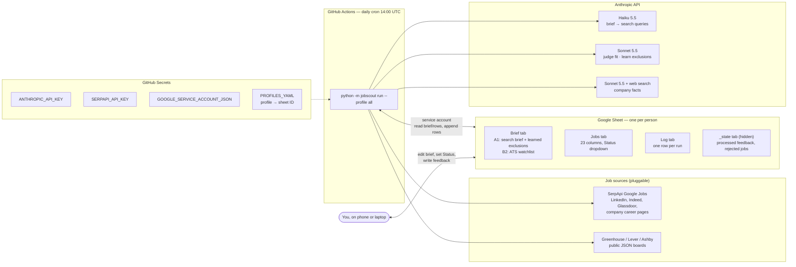
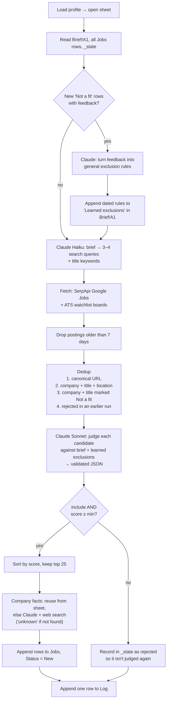
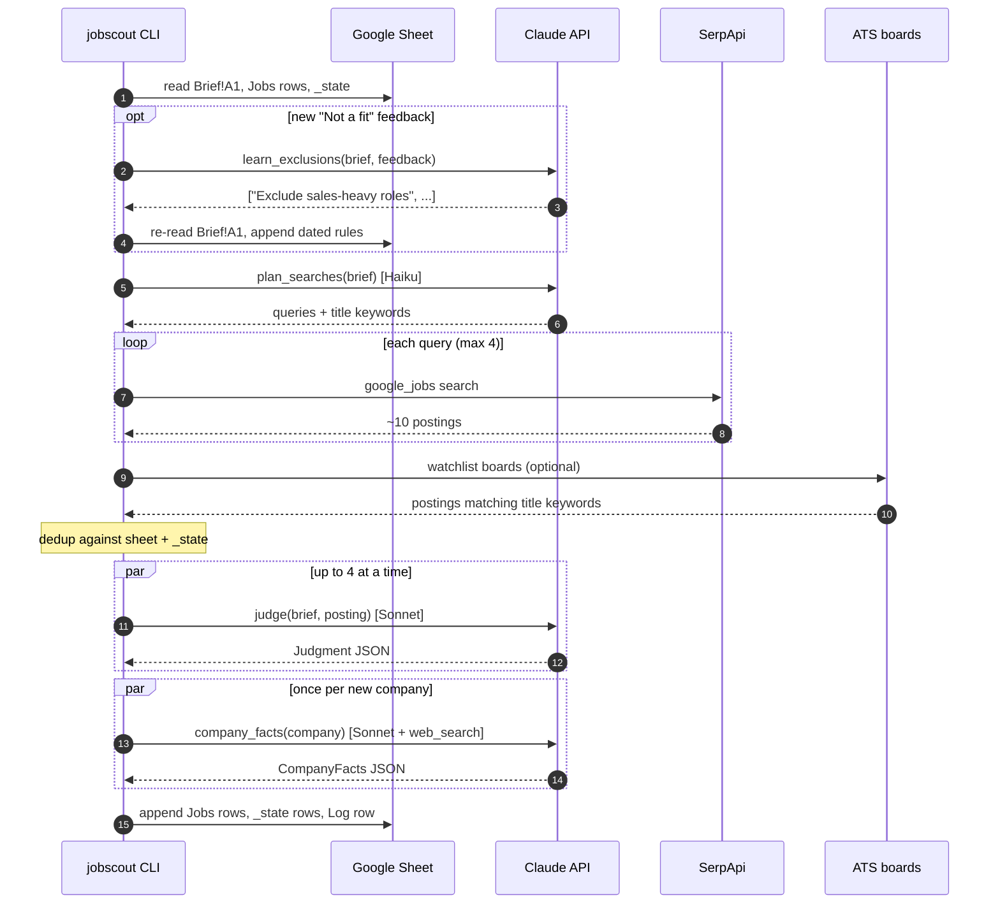
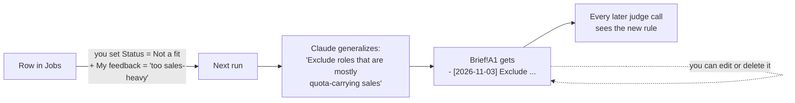
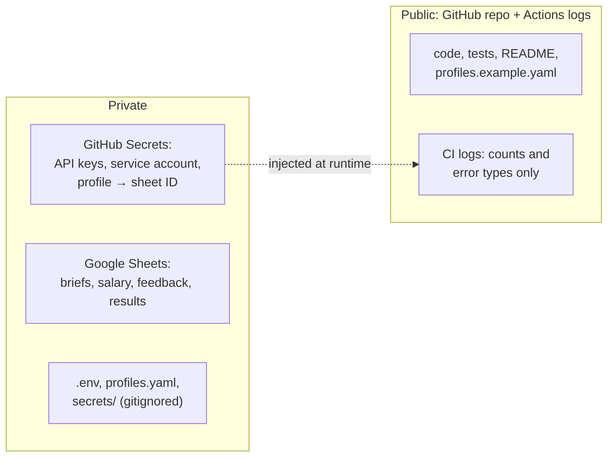

# Architecture

Job Scout is a small batch pipeline that runs once a day. It has no server, no database and no UI.
**Each person's Google Sheet is their UI and their storage.** GitHub Actions is the scheduler,
and Claude does the reasoning.

## System overview



## One run, step by step



## Sequence (one profile)



## Feedback loop



- The feedback key is (row URL, company+title+location, feedback text), stored in `_state`. Each piece of feedback is processed once. Editing the feedback text counts as new feedback.
- If you delete a learned rule, it stays deleted, because the feedback that produced it is already marked processed.
- Rows are never edited. The only writes to existing content are appends to the end of `Brief!A1`, and the agent re-reads the cell just before writing so it doesn't overwrite an edit you made from your phone.

## Code map

```
jobscout/
├── cli.py              argparse: run, init-sheet. Isolates profiles; CI-safe logging
├── config.py           profiles (profiles.yaml or PROFILES_YAML), credentials from env
├── models.py           RawJob dataclass, sheet column layout, tab names
├── pipeline.py         run_profile(): the steps above, plus RunReport
├── llm.py              Claude wrapper (structured JSON, Pydantic validation, pause_turn,
│                       refusal fallback) and the 4 tasks: plan / judge / facts / learn
├── dedup.py            canonical_url(), job_key(), company_title_key()
├── sheets.py           SheetStore (gspread), init_sheet() formatting + brief template
└── sources/
    ├── base.py         Source ABC, SearchPlan, date parsing
    ├── serpapi_google_jobs.py   Google Jobs → RawJob; prefers LinkedIn apply link
    └── ats.py          Greenhouse / Lever / Ashby boards + watchlist parsing
```

| Module | Depends on | Talks to |
|---|---|---|
| `pipeline` | `llm`, `dedup`, `sources`, a store object | nothing directly (store + sources are injected, so tests use fakes) |
| `llm` | `anthropic`, `pydantic` | Anthropic Messages API |
| `sheets` | `gspread`, `google-auth` | Google Sheets API |
| `sources/*` | `httpx` | SerpApi, ATS public APIs |

## Data model

**`Jobs`** (append-only, read by header name so you can add your own columns on the right):
Date added · Fit score · Job title · Company · Why it fits · Concerns · Location · Work mode ·
Employment type · Seniority · Salary range · Equity mentioned · Posted date · Company type/industry ·
Company size · Funding stage · HQ · Company description · Job URL · Company website · Source ·
**Status** (New / Interested / Applied / Not a fit) · **My feedback**

**`Log`**: Run at (UTC) · Found · Added · Skipped: duplicate · Skipped: excluded/low score · Skipped: over cap · New learned exclusions · Errors

**`_state`** (hidden): Kind (`feedback_processed` / `rejected`) · Key · Date

## Claude calls

| Task | Model | Input | Output (validated) |
|---|---|---|---|
| `plan_searches` | Haiku 5.5 | brief | `QueryPlan{queries[], title_keywords[]}` |
| `judge` | Sonnet 5.5, effort low | brief (cached system prompt) + one posting | `Judgment{include, fit_score 1–10, exclusion_reason, why_it_fits, concerns, work_mode, salary_range, equity_mentioned, ...}` |
| `company_facts` | Sonnet 5.5 + `web_search` (≤4 searches) | company, job links, excerpt | `CompanyFacts{industry, size, funding, hq, description, website}`, "unknown" if not found |
| `learn_exclusions` | Sonnet 5.5 | brief + new feedback rows | `LearnedPatterns{new_exclusions[]}` |

All calls use structured outputs (`output_config.format` with a strict JSON schema generated from the
Pydantic model). A response that fails validation is retried once. Postings, search results and feedback
are framed as data in every prompt, never as instructions.

## Reliability and limits

| Concern | How it's handled |
|---|---|
| One profile fails | Caught per profile; error goes to that sheet's `Log`; others continue; exit code 1 |
| One source fails | Recorded in `Log.Errors`; other sources still used |
| One judge call fails | Skipped; the posting is not recorded as rejected, so it gets another chance tomorrow |
| Cost runaway | ≤4 searches, ≤80 judged, ≤25 added per profile per run; rejected postings and known companies remembered |
| Duplicate cron runs | `concurrency: jobscout` in the workflow; dedup makes reruns safe anyway |
| DST | Cron is UTC: 6 AM PST / 7 AM PDT (see README) |

## Privacy boundary



## Extending

- **New source:** subclass `Source`, implement `fetch(plan, max_age_days) -> list[RawJob]`, and add it in `cli.py`. Dedup, judging and enrichment apply to it automatically.
- **New column:** add it to `JOBS_COLUMNS` (at the end, so existing sheets stay aligned) and fill it in `pipeline.py` step 6.
- **New person:** a new sheet, `init-sheet`, and one line in `PROFILES_YAML`. No code change.
