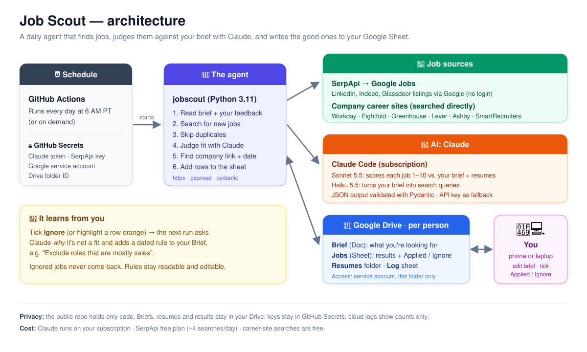
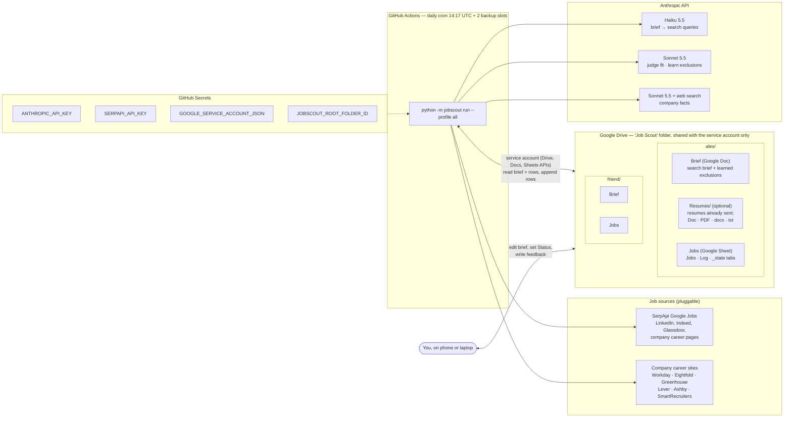
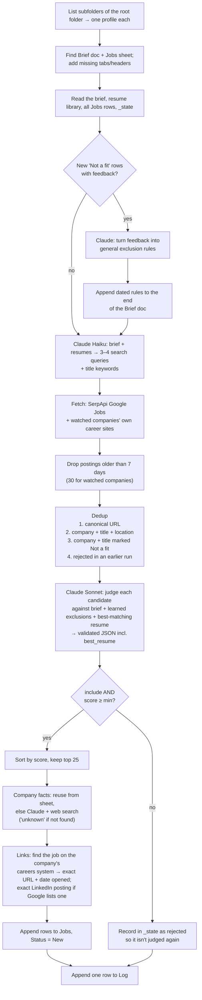
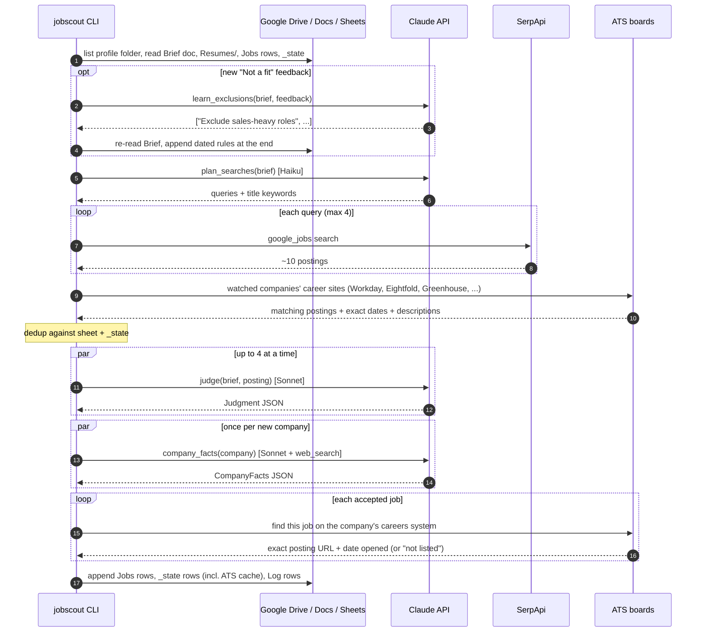
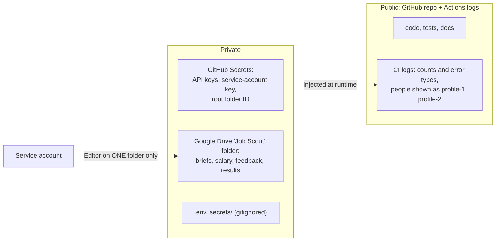

# Architecture

Job Scout is a small batch pipeline that runs once a day. It has no server, no database and no UI.
**Each person's Drive folder is their UI and their storage**: a Brief doc to steer the search, and a
Jobs sheet that collects results and feedback. GitHub Actions is the scheduler, and Claude does the reasoning.

## At a glance



## System overview



**Profiles are folders.** Every subfolder of the root "Job Scout" folder is one person. To add someone, you add
a folder with a `Brief` doc and an empty `Jobs` sheet. There's no config file and no secret to change.

## One run, step by step



## Sequence (one profile)



## Feedback loop


- The feedback key is (row URL, company+title+location, feedback text), stored in `_state`. Each piece of feedback is processed once. Editing the feedback text counts as new feedback.
- If you delete a learned rule, it stays deleted, because the feedback that produced it is already marked processed.
- The brief is updated with an **insert at the end** (Docs API), not a rewrite, so your text and formatting are never touched.
  It is re-read just before writing.

## Code map

```
jobscout/
├── cli.py              setup / run / template commands; isolates profiles; CI-safe logging
├── config.py           env-based settings, service-account credentials, Profile
├── models.py           RawJob dataclass, sheet column layout, tab names
├── pipeline.py         run_profile(): the steps above, plus RunReport
├── llm.py              Claude wrapper (structured JSON, Pydantic validation, pause_turn,
│                       refusal fallback) and the 4 tasks: plan / judge / facts / learn
├── dedup.py            canonical_url(), job_key(), company_title_key()
├── google_io.py        Drive (list, read/append brief, resume text extraction), profile discovery,
│                       sheet layout, DriveProfileStore
└── sources/
    ├── base.py         Source ABC, SearchPlan, date parsing
    ├── serpapi_google_jobs.py   Google Jobs → RawJob; prefers LinkedIn apply link
    └── company_sites.py         watched companies' own career sites + watchlist parsing
careers.py              ATS detection (Workday, Eightfold, Greenhouse, Lever, Ashby, SmartRecruiters), ATS search,
                        LinkResolver: company job URL + date opened + exact LinkedIn link, link verification
linkedin.py             LinkedIn link helpers (exact /jobs/view/ only, employer check)
```

| Module | Depends on | Talks to |
|---|---|---|
| `pipeline` | `llm`, `dedup`, `sources`, a store object | nothing directly (store + sources are injected, so tests use fakes) |
| `llm` | `anthropic`, `pydantic` | Anthropic Messages API |
| `google_io` | `gspread`, `google-auth` | Google Drive, Docs and Sheets APIs |
| `sources/*` | `httpx` | SerpApi, ATS public APIs |

## Data model

**Resumes/** (optional subfolder): resumes already sent. Up to 8 newest files, text extracted (Docs export, `pypdf`,
.docx XML, plain text), each truncated to 8k chars, and passed as `<resume name="…">` blocks.

**Brief** (Google Doc or `.txt`): free text. Sections: about me, target roles, seniority, location, compensation,
company preferences, nice-to-haves, "Don't show me", optional "Companies to watch" (`greenhouse:acme`),
then the auto-maintained "Learned exclusions".

**Jobs tab** (append-only, read by header name so you can add your own columns on the right):
Date added · Fit score · Job title · Company · Why it fits · Concerns · Location · Work mode ·
Employment type · Seniority · Salary range · Equity mentioned · Posted date · Company type/industry ·
Company size · Funding stage · HQ · Company description · Job URL · Company website · Source ·
**Status** (New / Interested / Applied / Not a fit) · **My feedback** · **Best resume**
(new columns are only ever added at the end; `setup` adds them to existing sheets automatically)

**Log tab**: Run at (UTC) · Found · Added · Skipped: duplicate · Skipped: excluded/low score · Skipped: over cap · New learned exclusions · Errors

**_state tab** (hidden): Kind (`feedback_processed` / `rejected` / `ats`) · Key · Date · Value (the ATS cache maps company → careers system)

## Claude calls

| Task | Model | Input | Output (validated) |
|---|---|---|---|
| `plan_searches` | Haiku 5.5 | brief + resume library | `QueryPlan{queries[], title_keywords[]}` |
| `judge` | Sonnet 5.5, effort low | brief + resume library (cached system prompt) + one posting | `Judgment{include, fit_score 1–10, exclusion_reason, why_it_fits, concerns, work_mode, salary_range, equity_mentioned, best_resume, ...}` |
| `company_facts` | Sonnet 5.5 + `web_search` (≤4 searches) | company, job links, excerpt | `CompanyFacts{industry, size, funding, hq, description, website}`, "unknown" if not found |
| `learn_exclusions` | Sonnet 5.5 | brief + new feedback rows | `LearnedPatterns{new_exclusions[]}` |

All calls use structured outputs (`output_config.format` with a strict JSON schema generated from the
Pydantic model). A response that fails validation is retried once. Postings, search results and feedback
are framed as data in every prompt, never as instructions.

## Reliability and limits

| Concern | How it's handled |
|---|---|
| One profile fails (e.g. missing Brief) | Caught per profile; error goes to that sheet's Log; others continue; exit code 1 |
| One source fails | Recorded in Log → Errors; other sources still used |
| One judge call fails | Skipped; the posting is not recorded as rejected, so it gets another chance tomorrow |
| Cost runaway | ≤4 searches, ≤80 judged, ≤25 added per profile per run; rejected postings and known companies remembered |
| Duplicate cron runs | `concurrency: jobscout` in the workflow; dedup makes reruns safe anyway |
| DST | Cron is UTC: 6 AM PST / 7 AM PDT (see README) |

## Security and privacy



- **Least privilege:** the service account has no access to anything except the folder you share with it. Un-sharing the folder revokes access immediately.
- **No personal data in the repo:** profiles are discovered from Drive at runtime. There's no `profiles.yaml` and no names or IDs in code.
- **Prompt-injection hygiene:** postings and web pages are untrusted input. Prompts label them as data, outputs are schema-constrained, and the agent can only append rows (it can't delete anything).

## Extending

- **New source:** subclass `Source`, implement `fetch(plan, max_age_days) -> list[RawJob]`, and add it in `cli.py`. Dedup, judging and enrichment apply to it automatically.
- **New column:** add it to `JOBS_COLUMNS` (at the end, so existing sheets stay aligned) and fill it in `pipeline.py` step 6.
- **New person:** a new subfolder with `Brief` + `Jobs`. No code or config change.
